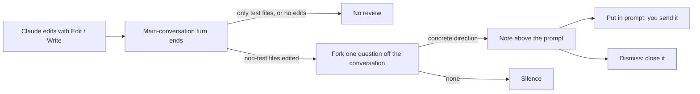

# Shouldn't you know?

English | [繁體中文](README.zh-TW.md)

> After Claude edits code, you get a structural note. Claude does not.

shouldnt-you-know is a Claude Code mod. When a main-conversation turn ends and that turn edited non-test files, it forks one question off the current conversation and asks a side reviewer to find structure that stays correct only through workarounds: two copies of the same data kept in sync, or a requirement held up by a special-case branch. If the reviewer has a concrete direction, a plain-language note appears above the prompt. If not, nothing appears.

The note is for you only. It is not written to the conversation, and Claude cannot read it on the next turn. If it makes sense to you, press **Put in prompt** to place it in the prompt box; you decide whether to send it, and you can add "what does this mean?" to have Claude explain it.

## How it works



The reviewer judges in two steps. First, it starts from the results that should hold once the task is fully delivered and works backward to the conditions that are easy to miss. Then it traces the actual usage flow to find where the current data structure conflates or loses distinctions, forcing sync, ordering, or special cases. It compares alternatives with five criteria: invalid states cannot be built, causes flow one way, local behavior is predictable, each fact has one authoritative source, and necessary complexity stays at real boundaries.

A note is plain prose with no fields or labels. It says four things: what the reviewer sees, why it would change it, what must not change, and what it would change it into. When the reviewer has no concrete direction it answers `none` and nothing appears; any other reply is shown whole, unchecked. **This shows the format; it is not real output:**

```text
Shouldn't you know?
sync() sends only adds and edits, and a delete only changes the local list, so an item deleted offline comes back on the next sync. The task needs offline changes to match after reconnecting, and that result must not change. Deletes could be recorded as operations too, so sync reads one operation log.
```

Notes already shown in the same session go into the next question, so the reviewer continues, revises, or drops an earlier concern instead of repeating it. Notes are written in the language you are using in the conversation.

## Relation to masters-nudge and You should know

The judgment comes from [masters-nudge](https://github.com/shihchengwei-lab/masters-nudge). The display follows You should know, which is built into Claude Code.

| | masters-nudge | You should know (built into Claude Code) | shouldnt-you-know |
|---|---|---|---|
| Looks at | Data and responsibility structure of the change | Anything in the conversation the user might miss | Data and responsibility structure of the change |
| Reader | The coding model | The user | The user |
| Delivery | Into the coding model's context | Above the prompt | Above the prompt, never into Claude's context |
| Reviewer | A different model (OpenAI / Codex) | Forked from the conversation | Forked from the conversation |

The masters-nudge benchmarks measure a different model advising the coding model, so they do not carry over to this mod. Here the reviewer is the same model reading the same conversation as Claude; its value has to be judged in use.

## Install

```shell
claude plugin marketplace add shihchengwei-lab/cc-mod-shouldnt-you-know
claude plugin install shouldnt-you-know@shihchengwei-lab
```

To try it for one session without installing:

```shell
git clone https://github.com/shihchengwei-lab/cc-mod-shouldnt-you-know
claude --plugin-dir ./cc-mod-shouldnt-you-know
```

## Usage and limits

- Tested only on Claude Code 2.1.288. The function hooks API that mods use is in early access, so a Claude Code update may require changes here.
- Only successful edits through Edit, Write, MultiEdit, and NotebookEdit count. If Claude writes a file with a Bash command, that turn does not trigger a review.
- Test-only detection follows the masters-nudge convention: paths under `test`, `tests`, `__tests__`, or `__snapshots__`, or file names matching `test_*`, `*.test.*`, `*.spec.*`, `*_test.go`, or `*.snap`. Matching is case-sensitive.
- A subagent's own turns, and turns that end by interruption or error, do not trigger a review.
- Each note costs one extra model call on your usage. The fork reuses the main conversation's prompt cache, so most of the conversation is not billed again; once the cache entry lapses or the model changes, the whole conversation is billed again.
- The reviewer cannot use tools. It sees only what already appears in the conversation, not related files Claude never read.
- "The note never enters Claude's context" rests on the Claude Code mod documentation and this repository's automated tests.

## Privacy

The reviewer's question goes out through your current session's connection and account. It contains the current conversation plus this mod's judgment prompt, and goes to no other service. Notes live only in this session's state: they are not written to the conversation and not saved anywhere else.

## Development

```shell
claude plugin validate --strict .
claude plugin test .
```

The judgment prompt is in [hooks/prompt.ts](hooks/prompt.ts), reply parsing and test-file detection in [hooks/parse.ts](hooks/parse.ts), and event handling and drawing in [hooks/register.tsx](hooks/register.tsx).

License: [MIT](LICENSE)
