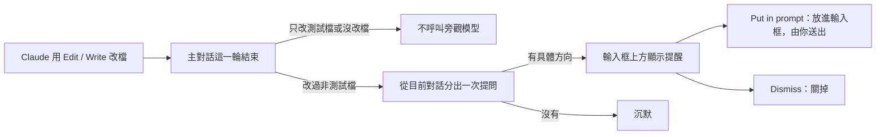

# Shouldn't you know?

[English](README.md) | 繁體中文

> Claude 改完程式後，給你看一則結構提醒；Claude 看不到。

shouldnt-you-know 是一個 Claude Code mod。主對話的一輪結束、而且這輪改過非測試檔時，它從目前的對話分出一次提問，請旁觀模型找出「靠補救才勉強成立的結構」：例如同一件事有兩份資料要互相同步，或某個要求只靠特殊分支撐住。有具體方向，就在輸入框上方顯示一則白話提醒；沒有，就不出聲。

提醒只給你看。它不會寫進對話紀錄；依 Claude Code 的 mod 文件，Claude 下一輪也讀不到。你看了覺得有道理，按 **Put in prompt** 把它放進輸入框，自己決定要不要送出、要不要加一句「這是什麼意思」請 Claude 解釋。

## 它怎麼運作



旁觀模型的判斷分兩步。先從「任務完整交付後應該成立的結果」回推容易漏掉的條件；再追實際使用流程，找出目前資料結構把哪些區別混在一起或弄丟了，導致需要同步、排序或特殊處理。比較替代結構時用五條準則：讓非法狀態無法建構、因果單向、局部行為可預測、每個事實只有一個權威來源、必要的複雜度留在真正的邊界。

提醒是一段不分欄、不加標籤的白話，講四件事：看到什麼、為什麼想改、什麼不能動、想改成什麼樣。旁觀模型沒有具體方向時只回 `none`，畫面上什麼都不出現；其他回覆不檢查內容，整段原樣顯示。**以下是格式示意，不是實際輸出：**

```text
Shouldn't you know?
sync() 只送出新增和修改，刪除只改了本地清單，所以離線刪掉的項目會在下次同步時復活。任務要求離線操作上線後一致，這個結果不能動。可以把刪除也記成一筆操作，讓同步只讀一份操作紀錄。
```

同一個 session 裡已經顯示過的提醒，會附在下一次提問裡，讓旁觀模型延續、修正或放下前一個疑慮，不重複講同一件事。提醒用你當下對話的語言寫。

## 跟 masters-nudge、You should know 的關係

判斷邏輯來自 [masters-nudge](https://github.com/shihchengwei-lab/masters-nudge)，顯示方式參考 Claude Code 內建的 You should know。

| | masters-nudge | You should know（Claude Code 內建） | shouldnt-you-know |
|---|---|---|---|
| 看什麼 | 這次修改的資料與責任結構 | 整段對話裡使用者可能漏掉的事 | 這次修改的資料與責任結構 |
| 給誰看 | 寫程式的模型 | 使用者 | 使用者 |
| 送達方式 | 進入寫程式模型的脈絡 | 輸入框上方 | 輸入框上方，不進入 Claude 的脈絡 |
| 旁觀模型 | 另一個模型（OpenAI／Codex） | 從目前對話分出 | 從目前對話分出 |

masters-nudge 的測試結果量的是「另一個模型給寫程式的模型建議」，不能直接套用到這個 mod。這裡的旁觀模型和 Claude 是同一個模型、讀同一段對話，效果要另外看實際使用。

## 安裝

```shell
claude plugin marketplace add shihchengwei-lab/cc-mod-shouldnt-you-know
claude plugin install shouldnt-you-know@shihchengwei-lab
```

只想在一個 session 試用，不安裝：

```shell
git clone https://github.com/shihchengwei-lab/cc-mod-shouldnt-you-know
claude --plugin-dir ./cc-mod-shouldnt-you-know
```

## 使用與限制

- 只在 Claude Code 2.1.288 上測過。mod 用的 function hooks API 還在 early access，Claude Code 更新後可能需要跟著改。
- 只辨識 Edit、Write、MultiEdit、NotebookEdit 成功改檔。Claude 用 Bash 指令直接寫檔，那一輪不會觸發。
- 純測試檔的判斷沿用 masters-nudge 的慣例：路徑在 `test`、`tests`、`__tests__`、`__snapshots__` 底下，或檔名符合 `test_*`、`*.test.*`、`*.spec.*`、`*_test.go`、`*.snap`。大小寫要完全相符。
- 子代理自己的回合、被中斷或出錯結束的回合，不觸發。
- 每則提醒是一次額外的模型呼叫，算在你的用量裡。分出的提問沿用主對話的 prompt cache，大部分對話內容不用重新計費；cache 過期或換過模型後，會重新計費整段對話。
- 旁觀模型不能使用工具，只看得到對話裡已經出現的內容。Claude 沒讀過的相關檔案，它看不到。
- 「提醒不會進入 Claude 的脈絡」依據的是 Claude Code 的 mod 文件與本 repo 的自動測試。

## 隱私

旁觀模型的提問透過你目前 session 的連線與帳號送出，內容是目前的對話加上本 mod 的判斷指令，不送到其他服務。提醒只存在這個 session 的狀態裡，不寫進對話紀錄，也不另外存檔。

## 開發

```shell
claude plugin validate --strict .
claude plugin test .
```

判斷指令在 [hooks/prompt.ts](hooks/prompt.ts)，回覆解析與測試檔判斷在 [hooks/parse.ts](hooks/parse.ts)，事件處理與畫面在 [hooks/register.tsx](hooks/register.tsx)。

授權：[MIT](LICENSE)
